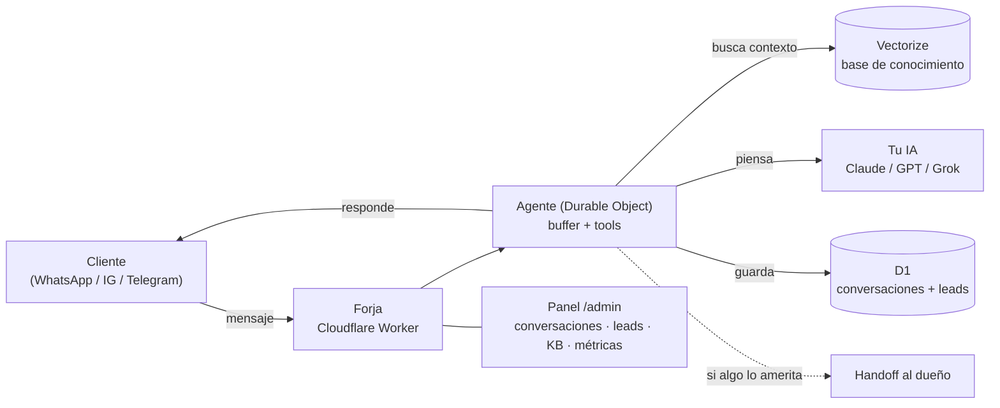

<div align="center">

# 🔨 Forja

### Tu chatbot de IA para WhatsApp, Instagram y Telegram — en **tu propia nube**, gratis y open source.

**Atiende a tus clientes 24/7, responde desde tu base de conocimiento, y te avisa a ti cuando algo lo amerita.** Vive en tu cuenta de Cloudflare, con tu llave de IA. Tus datos son tuyos. Sin mensualidades de SaaS.

<em>Self-hosted, open-source AI support bot for small businesses. Lives in **your** Cloudflare, uses **your** AI key. Spanish-first. Deploy in minutes.</em>

[](./LICENSE)
[](https://workers.cloudflare.com/)
[](https://horizontesia.com)

[**Instalar**](#-instalar-en-5-minutos) · [**Cómo funciona**](#-cómo-funciona) · [**Forja+**](#-forja-los-14-giros-y-el-modo-agencia) · [**Comunidad**](https://horizontesia.com)

</div>

---

## ¿Qué es Forja?

Un asistente de soporte con IA que montas **en tu propia infraestructura de Cloudflare** en una tarde — sin saber programar. En lugar de pagar una mensualidad a un SaaS que se queda con tus conversaciones, Forja vive en tu cuenta, con tu llave de IA, y **todo es tuyo**.

- 💬 **Multicanal** — WhatsApp, Instagram, Messenger y Telegram desde un mismo cerebro.
- 📚 **Aprende de tus documentos** — subes tus FAQ, políticas y guías; el bot busca ahí antes de responder (RAG con base vectorial).
- 🎙️ **Entiende notas de voz** — transcribe los audios de tus clientes automáticamente.
- 🙋 **Sabe cuándo pedir ayuda** — si algo es delicado o no está seguro, te hace _handoff_ a ti.
- 📊 **Panel de administración** — conversaciones, leads, base de conocimiento y métricas, todo en `/admin`.
- ☁️ **Vive en tu Cloudflare** — rápido, barato y sin servidores que mantener.
- 🧠 **Tu cerebro, tu llave** — Claude, ChatGPT o Grok; tú eliges y pagas solo lo que piensa.

> **No necesitas saber programar.** Forja se instala y configura con [Claude Code](https://claude.com/claude-code) como tu copiloto — él corre los comandos por ti, paso a paso.

---

## 🚀 Instalar en 5 minutos

### Opción A — con Claude Code (recomendado, no necesitas saber programar)

Abre [Claude Code](https://claude.com/claude-code) en tu terminal y dile:

```
ármame un chatbot con Forja
```

Claude te explica cómo funciona y cuánto cuesta, verifica que tengas lo necesario, y monta todo por ti: crea tu Cloudflare, despliega el bot y te entrega tu panel vivo. Por debajo corre:

```bash
npx forjabot init
```

### Opción B — manual (si ya programas)

Necesitas Node.js 20 o 22 y pnpm 10.34.5.

```bash
git clone https://github.com/santmun/forja mi-chatbot
cd mi-chatbot
pnpm install
# Configura wrangler.toml (tu nombre de worker) y tus secretos
npx wrangler d1 create horizontes_bot_db  # → pega el database_id en wrangler.toml
npx wrangler secret put ANTHROPIC_API_KEY # (o OPENAI/XAI)
npx wrangler secret put DASHBOARD_PASSWORD # contraseña única de 16+ caracteres
pnpm db:apply:remote
pnpm run deploy
```

Tu panel queda en `https://<tu-worker>.workers.dev/admin`.

[](https://deploy.workers.cloudflare.com/?url=https://github.com/santmun/forja)

---

## 💸 Cuánto cuesta

Forja es **gratis y open source**. Lo único que pagas es tu propia infraestructura, y arranca casi en cero:

| Pieza                            | Costo                                             | Notas                                                               |
| -------------------------------- | ------------------------------------------------- | ------------------------------------------------------------------- |
| **Cloudflare** (la casa del bot) | **$0** para empezar · ~$5/mes ya con tráfico real | D1, Vectorize y R2 tienen capa gratis generosa                      |
| **Cerebro de IA** (tu llave)     | ~**$1–2/mes** para un negocio normal              | Pagas solo lo que el bot piensa; tu llave, cifrada en tu Cloudflare |

Nadie más toca tus datos ni tus conversaciones.

---

## 🧠 Cómo funciona



Un mensaje entra por un canal → el agente arma contexto desde tu base de conocimiento → tu IA redacta la respuesta con la voz de tu negocio → se responde y se guarda. Si algo es delicado, te avisa a ti.

---

## 🧩 Stack

- **[Cloudflare Workers](https://workers.cloudflare.com/)** (Hono) — el runtime del bot.
- **[Vercel AI SDK](https://sdk.vercel.ai/)** — capa de LLM (Anthropic / OpenAI / xAI, con llave propia).
- **D1** (SQLite) — conversaciones, leads, configuración.
- **Vectorize** (bge-m3) — base de conocimiento / RAG.
- **R2** — media (imágenes, audios).
- **Durable Objects** — el agente que piensa y responde (buffer + tools).

Todo en el ecosistema de Cloudflare: un solo `pnpm run deploy` y está en línea.

---

## ⭐ Forja+ — los 14 giros y el Modo Agencia

El Starter de este repo sirve para **cualquier negocio**. Si quieres ir más allá, **Forja+** (con la comunidad de [Horizontes IA](https://horizontesia.com)) desbloquea:

- 🎯 **14 giros con panel a la medida** — barbería, restaurante, inmobiliaria, clínica, spa, gimnasio, hotelería y más, cada uno con sus herramientas (reservaciones, agenda, calificar prospectos…).
- 🤖 **Comandos que trabajan por ti** — `/mantenimiento`, `/campaña`, `/afinar`, `/clonar` (arma tu KB desde tu web), `/precios`…
- 💼 **Modo Agencia** — arma y **revende** bots a otros negocios, con cotizador y propuesta incluidos.
- 👥 **Comunidad + soporte** — 600+ personas construyendo con IA en español, y actualizaciones gestionadas.

👉 **[Únete a Horizontes IA →](https://horizontesia.com)**

---

## 🔒 Privacidad — quién ve los datos

**Nadie más que tú.** Forja corre en TU cuenta de Cloudflare con TUS llaves: las conversaciones de tus clientes viven en tu base de datos y **el bot no envía telemetría ni datos de uso a Horizontes IA ni a nadie**. No hay ping de activación ni analíticas ocultas — puedes revisarlo tú mismo en `src/`.

- Los **mensajes se borran solos a los 90 días** (cron diario). Los leads y tickets se quedan hasta que tú los borres.
- **No se guardan audios ni imágenes**: se transcriben o describen y solo queda el texto.
- Los links del bot cuentan clics, **sin IP ni navegador**.
- El texto de la conversación sí viaja al **proveedor de IA que tú elegiste** (con tu llave) para poder responder.
- Si preguntan si es un bot, **el bot lo admite**. No lo configures para negarlo.

Como dueño del negocio, **tú eres el responsable** de esos datos: avisa a tus clientes que la atención es automatizada y que guardas la conversación, y atiende las solicitudes de borrado. Todo el detalle está en [`PRIVACY.md`](./PRIVACY.md).

### Acceso al panel administrativo

`/admin` siempre exige HTTP Basic Auth con el usuario fijo `admin`.
`DASHBOARD_PASSWORD` debe tener al menos 16 caracteres; si falta o es más corta,
el panel falla cerrado sin mostrar el valor. Usa una contraseña aleatoria,
exclusiva y guardada en un gestor de contraseñas:

```bash
pnpm wrangler secret put DASHBOARD_PASSWORD
```

Para rotarla, ejecuta de nuevo el mismo comando, publica la nueva versión y
verifica el acceso en una ventana privada. Las respuestas administrativas usan
`Cache-Control: no-store`, bloquean framing y no envían referrer. El Bearer
opcional `CONTROL_PLANE_TOKEN` de `/api/*` requiere al menos 32 caracteres y
permanece cerrado cuando falta o es corto.

Forja no mantiene un contador de fallos dentro del Worker: la memoria de un
isolate no es un rate limiter distribuido ni durable. Instalaciones expuestas a
Internet que necesiten bloqueo por IP deben añadir Cloudflare Rate Limiting,
WAF o Access en el perímetro.

### Seguridad de medios remotos

Los audios e imágenes solo se aceptan desde hostnames HTTPS exactos. Telegram,
Twilio y el proxy firmado de WhatsApp usan hosts derivados del propio proveedor
o de `DASHBOARD_BASE_URL`. ManyChat, adaptadores aprendidos, Messenger e
Instagram usan CDNs variables y quedan cerrados por defecto hasta configurar la
variable no secreta `MEDIA_ALLOWED_HOSTS` con una lista de hostnames exactos
separados por comas.

No uses URLs, puertos, paths, IPs ni comodines en esa lista. Cada hostname amplía
la superficie de descarga y debe pertenecer a un proveedor administrado por ti.
La política se vuelve a aplicar en cada redirección y mantiene límites de tiempo
y tamaño.

Esta allowlist reduce el riesgo de SSRF y DNS rebinding desde payloads
arbitrarios, pero un dominio permitido que sea comprometido o cambie su DNS
sigue siendo un riesgo residual. Instalaciones con requisitos estrictos deben
añadir un egress confiable mediante un Service Binding o proxy que aplique
políticas de resolución y red.

### Autenticidad de webhooks

Los webhooks entrantes se validan antes de parsear o activar el agente:

- Telegram exige el `secret_token` registrado con `setWebhook` y lo compara
  con `TELEGRAM_WEBHOOK_SECRET`.
- Twilio valida `X-Twilio-Signature` con `TWILIO_AUTH_TOKEN` y la URL pública
  exacta. Si usas proxy o dominio personalizado, configura
  `TWILIO_WEBHOOK_URL`.
- ManyChat exige el header `X-Forja-Webhook-Secret` con
  `MANYCHAT_WEBHOOK_SECRET`, también durante el aprendizaje temporal.
- Meta y WhatsApp Cloud validan `X-Hub-Signature-256` con su App Secret.

Todos los canales fallan cerrados cuando falta su secreto. Al actualizar una
instalación existente, guarda los nuevos secrets y vuelve a registrar/configurar
el webhook antes de enviar tráfico. Nunca pegues secretos en chats, código,
logs o `wrangler.toml`; usa `wrangler secret put`.

---

## 🤝 Contribuir

Los PRs son bienvenidos. Lee [`CONTRIBUTING.md`](./CONTRIBUTING.md) para el flujo, y abre un issue si tienes una idea o encuentras un bug. Este repo es el **Starter** open source; los giros y comandos de Forja+ viven aparte.

### Calidad y seguridad

El proyecto verifica Node 20 y 22 en CI. Para validar un cambio local sin desplegar:

```bash
pnpm install --frozen-lockfile
pnpm check
pnpm test:coverage
pnpm security:audit
```

También están disponibles `pnpm format`, `pnpm lint:fix` y `pnpm check:ci`. La cobertura se
genera en `coverage/`. Consulta [`SECURITY.md`](./SECURITY.md) para reportar una
vulnerabilidad de forma privada.

## 📄 Licencia

[MIT](./LICENSE) © Horizontes IA. Úsalo, modifícalo y móntalo para quien quieras.

<div align="center">

**Hecho con 🔨 por [Horizontes IA](https://horizontesia.com)** · [YouTube](https://youtube.com/@horizontesia) · [Comunidad](https://horizontesia.com)

</div>
